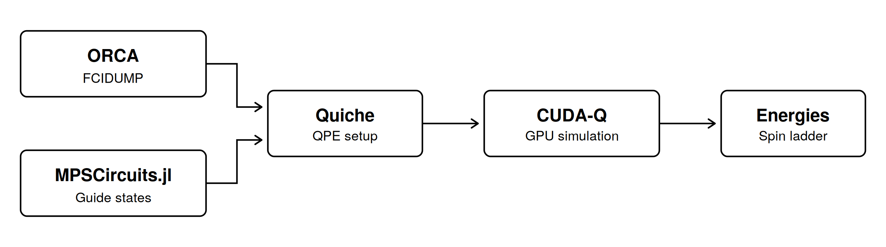
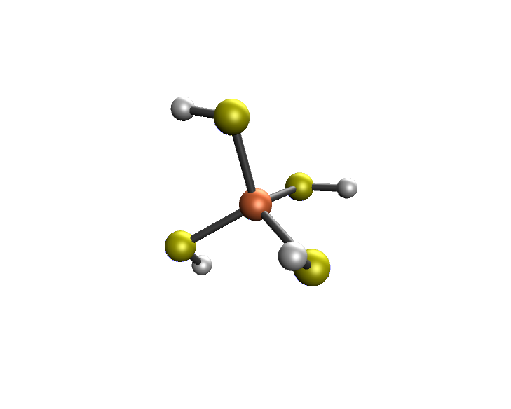

  # Quiche + CUDA-Q: A fully integrated end-to-end quantum chemistry pipeline
---  

   
  <em>End-to-end integration of different software stacks using Quiche and CUDA-Q</em>

Quantum Motion and NVIDIA are working together to provide a fully integrated quantum chemistry pipeline for resource estimation and simulation for quantum computing applications. Quiche is a joint project between Quantum Motion, FACCTS and RiverLane, which aims to integrate quantum computing into standard quantum chemistry workflows. Combined with NVIDIA's accelerated compute capabilities and their CUDA-Q and CUDA-Q algorithms platforms, we take a step forward in setting up a fully integrated end-to-end pipeline that can be used for both simulation and, later down the line, resource estimation of complex electronic structure calculations. In this demo, we will show off the simulation side by starting from an ORCA simulation, setting up the quantum algorithm using Quiche and Cuda-Q and finally running the simulation on an NVIDIA backend. 

### One pipeline, different software stacks

A quantum algorithm for chemistry is only useful if a chemist can load a molecule onto a quantum computer, and get an answer back out. In practice, that means stitching together tools that were never designed to talk to interact with one another. We want to build a single pipeline that integrates different software stacks into a single toolbox, playing to the strengths of each of the individual components.

- ORCA is an industry-standard quantum chemistry package. We use it to run the classical calculations and to export the active-space integrals as a standard FCIDUMP file.
- Quiche is the glue. It reads the FCIDUMP, and lets the user specify the algorithm at a high level: which Hamiltonian, which flavour of quantum phase estimation (QPE), which simulation method, and, crucially, a target energy error.
- CUDA-Q and CUDA-Q Algorithms is NVIDIA's open-source platform for hybrid quantum-classical programming. CUDA-Q Algorithms builds the qubit Hamiltonians, and the QPE circuits that Quiche generates are run as CUDA-Q kernels, on NVIDIAs high-performance backend.  

The result is that, from the user's perspective, the workflow is a short Python notebook: ORCA in, energies out, with no hand-written circuits or manual conversion steps in between. The same Quiche specification that drives the simulation is also the starting point for resource estimation, meaning that in the era of fault-tolerant quantum computing (FTQC), our pipeline stays virtually unchanged.  
  
### Spin state energetics of Iron-Sulfur systems  

   
  <em>Chemical structure of Fe(SH)4-</em>

The identity of the ground spin state is crucial for understanding reactivity, electrochemistry and photochemistry. Furthermore, the energy differences between the ground spin state and states of other multiplicity are needed to predict, for example, spectroscopy. Iron-sulfur systems are an especially delicate target for these so-called spin state energetics, as the different spin states have been reported to be within sub-miliHartree of each other for certain clusters. Different methods, as well as the inclusion or omission of dynamic correlation effects, can also result in different orderings of the spin ladder. As the target system, we choose Fe(SH)4&minus; in a minimal 5 electron in 5 orbitals active space. It functions as a minimal example of an Fe-S cluster, but has its own chemical relevance as it is a minimal model of the iron site of rubredoxin, the simplest natural iron–sulfur protein. We purposefully choose a small system and active space. It lets us check every QPE result against an exact reference (complete active space self-consistent field (CASSCF) calculations over the full active space), and it means the pipeline can be run end to end on a single GPU.

### Try it yourself

This pipeline will allow us to push the limits of what chemical problems we can tackle, ranging from larger more complex simulations up to resource estimates for systems that are no longer classically simulable. The full demo, is available [here](./FeSH4_demo.ipynb). If you want to know more about the state preparation step using **MPSCircuit.jl** check out our [earlier blogpost](https://quantummotion.com/state-preparation-for-quantum-chemistry-with-quantum-motion-and-nvidia-cuda-q/).

### About the authors

<ins>Xeno De Vriendt</ins> is an Applications Scientist at Quantum Motion. Xeno obtained a DPhil in Chemistry from the University of Ghent for research on (classical) quantum chemical method development, After which he worked as a post-doctoral researcher in the quantum computing team at BASF Ludwigshafen. At Quantum Motion, Xeno is working on identifying use cases for quantum computing and algorithm development, both with a focus on chemistry.

<ins>Zohim Chandani</ins> is a Quantum Algorithms and Applications Engineer at NVIDIA. His work spans scaling up quantum algorithms, use of AI across the quantum stack and the utility of quantum-GPU supercomputing.

<ins>Thomas Bromley</ins> is the Applications Lead at Quantum Motion, working to identify quantum computing use cases and develop the underlying quantum algorithms. Tom has over a decade of experience in quantum computing and leads a team of researchers and software developers to build applications that complement Quantum Motion’s silicon spin quantum dot hardware.